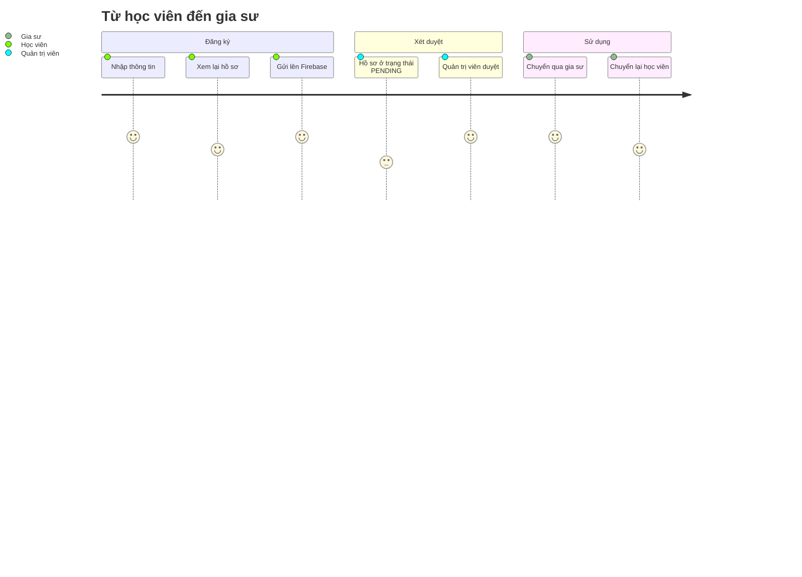
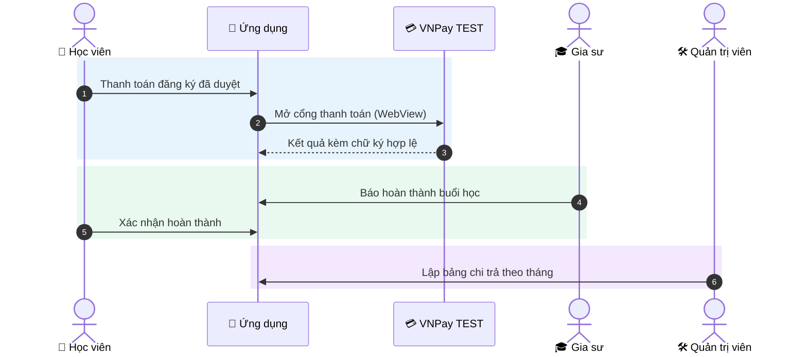
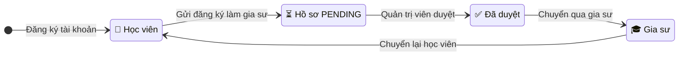
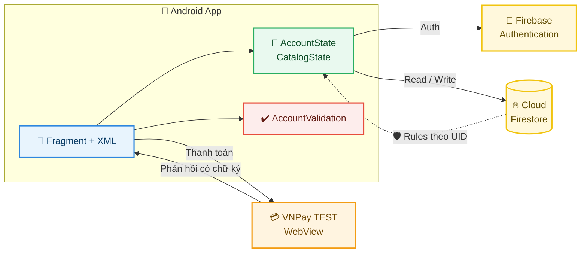
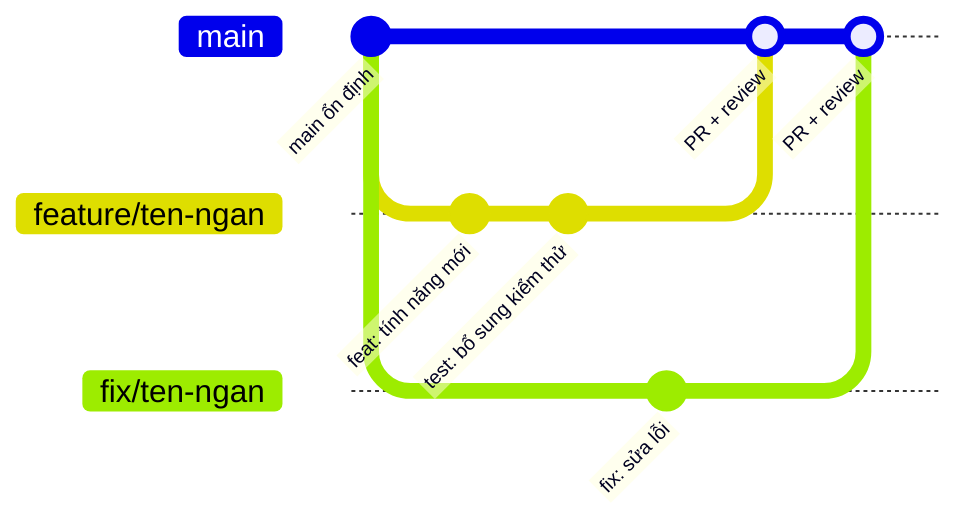
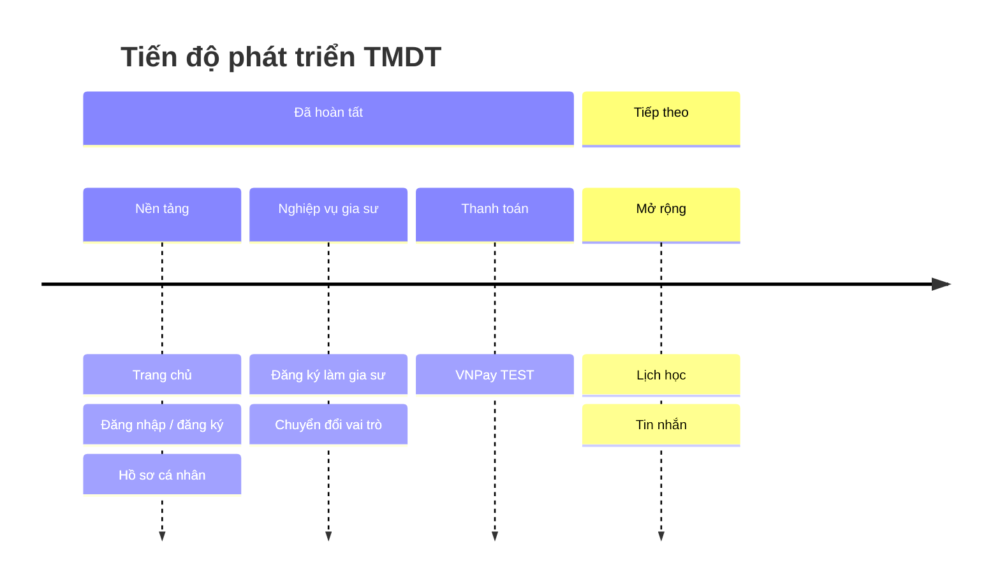

<a id="top"></a>

<div align="center">


<a href="https://github.com/pvhNam/TMDT_CK">
  
</a>

<br/>


<br/>


<br/>

**[🚀 Bắt đầu](#bat-dau) &nbsp;•&nbsp; [✨ Tính năng](#tinh-nang) &nbsp;•&nbsp; [🏗️ Kiến trúc](#kien-truc) &nbsp;•&nbsp; [🗃️ Dữ liệu](#du-lieu) &nbsp;•&nbsp; [⚙️ Cấu hình](#cau-hinh) &nbsp;•&nbsp; [🤝 Phát triển](#phat-trien) &nbsp;•&nbsp; [📦 Phát hành](#phat-hanh) &nbsp;•&nbsp; [🩺 Sự cố](#su-co) &nbsp;•&nbsp; [❓ FAQ](#faq)**

</div>


> [!NOTE]
> **TMDT** là ứng dụng Android dành cho **học viên** và **gia sư**. Giao diện theo thiết kế Figma (`thiết kế giao diện mobile_1.docx`); dữ liệu rút gọn từ `03_Thiet_ke_CSDL_v4.md`, chỉ giữ các luồng nghiệp vụ đang dùng.

<!--
  ẢNH CHỤP MÀN HÌNH — bỏ comment và thay đường dẫn khi đã có ảnh:

  <div align="center">
    
    
    
    
  </div>
-->

<a id="tong-quan"></a>

## 🧭 Tổng quan nhanh

| Thuộc tính | Giá trị |
| --- | --- |
| 📦 Loại sản phẩm | Ứng dụng di động Android (Java, Fragment + XML) |
| 📲 Nền tảng tối thiểu | Android 10 |
| ☕ Môi trường build | JDK 21, Gradle (Kotlin DSL) |
| 🔑 Xác thực | Firebase Authentication — Email/Password |
| 🔥 Cơ sở dữ liệu | Cloud Firestore + Security Rules |
| 💳 Thanh toán | VNPay TEST (WebView) |
| ☁️ Firebase project | `tmdt-3e274` |
| 🌿 Nhánh chính | `main` |
| 🚦 Trạng thái | Đang phát triển tích cực |

<a id="noi-bat"></a>

## 🌟 Điểm nổi bật

<div align="center">


</div>


## 📚 Mục lục

<table>
<tr>
<td valign="top">

1. [🧭 Tổng quan nhanh](#tong-quan)
2. [🌟 Điểm nổi bật](#noi-bat)
3. [✨ Tính năng](#tinh-nang)
4. [👥 Vai trò và phân quyền](#vai-tro)
5. [🏗️ Kiến trúc](#kien-truc)
6. [🗃️ Mô hình dữ liệu](#du-lieu)
7. [🚀 Bắt đầu nhanh](#bat-dau)

</td>
<td valign="top">

8. [⚙️ Cấu hình môi trường](#cau-hinh)
9. [🤝 Quy trình phát triển](#phat-trien)
10. [🧪 Kiểm thử](#kiem-thu)
11. [📦 Phát hành](#phat-hanh)
12. [🔐 Bảo mật](#bao-mat)
13. [⚠️ Giới hạn đã biết](#gioi-han)
14. [🩺 Xử lý sự cố](#su-co)

</td>
<td valign="top">

15. [❓ Câu hỏi thường gặp](#faq)
16. [📖 Thuật ngữ](#thuat-ngu)
17. [🗺️ Lộ trình](#lo-trinh)
18. [📚 Tài liệu](#tai-lieu)
19. [📜 Giấy phép](#giay-phep)
20. [💬 Đóng góp và liên hệ](#lien-he)
21. [🙏 Ghi nhận](#ghi-nhan)

</td>
</tr>
</table>

---

<a id="tinh-nang"></a>

## ✨ Tính năng

| | Hạng mục | Mô tả | Trạng thái |
| :-: | --- | --- | :-: |
| 🔑 | **Xác thực** | Email/Password, xác nhận mật khẩu, lưu phiên, quên mật khẩu qua email | ✅ Hoàn tất |
| 🏠 | **Trang chủ** | Banner, tìm kiếm không dấu, lọc theo môn, danh sách gia sư thời gian thực | ✅ Hoàn tất |
| 👤 | **Hồ sơ cá nhân** | Thông tin, địa chỉ, số điện thoại, ảnh đại diện, cấp học, mục tiêu | ✅ Hoàn tất |
| 🎓 | **Đăng ký gia sư** | Nhập → xem lại → gửi; hồ sơ `PENDING` chờ duyệt; chuyển đổi vai trò | ✅ Hoàn tất |
| 💳 | **Thanh toán** | VNPay TEST trong WebView, chỉ ghi nhận khi phản hồi có chữ ký hợp lệ | ✅ Hoàn tất |
| 🛡️ | **Phân quyền dữ liệu** | Firestore Rules theo UID, chặn nâng quyền, chặn client sửa danh mục | ✅ Hoàn tất |
| 📱 | **Xác thực điện thoại** | OTP, chức năng bổ sung | ⚙️ Tùy chọn |
| 📅 | **Lịch học** | Màn hình chờ | 🚧 Đang phát triển |
| 💬 | **Tin nhắn** | Màn hình chờ | 🚧 Đang phát triển |

### 🎓 Hành trình đăng ký làm gia sư



### 💸 Luồng thanh toán

<div align="center">


</div>

<details>
<summary><b>🔍 Xem sơ đồ tuần tự chi tiết (bấm để mở)</b></summary>



</details>

<details>
<summary><b>🗑️ Đã loại bỏ khỏi phạm vi (bấm để xem)</b></summary>

<br/>

Tin đăng / ứng tuyển / lời mời · minh chứng bằng cấp · hợp đồng chống dạy ngoài · học thử / điểm danh · đánh giá · cấu hình hệ thống.

Chi tiết: [FIRESTORE_SCHEMA.md](FIRESTORE_SCHEMA.md)

</details>

<p align="right"><a href="#top">⬆️ Về đầu trang</a></p>

<a id="vai-tro"></a>

## 👥 Vai trò và phân quyền

| Vai trò | Có thể làm gì |
| :-: | --- |
| 🎒 **Học viên** | Tìm kiếm không dấu, lọc theo môn, xem hồ sơ gia sư, quản lý hồ sơ cá nhân, thanh toán học phí |
| 🎓 **Gia sư** | Đăng ký hồ sơ gia sư, chờ duyệt, chuyển đổi vai trò, báo hoàn thành buổi học |
| 🛠️ **Quản trị viên** | Duyệt hồ sơ gia sư, quản lý danh mục gia sư/môn dạy, lập bảng chi trả theo tháng |

### 🔄 Vòng đời vai trò



### 🛡️ Ma trận quyền truy cập dữ liệu

| Hành động | Người dùng (client) | Cơ chế |
| --- | :-: | --- |
| Đọc/ghi hồ sơ `users/{UID}` của chính mình | ✅ | Firestore Rules theo UID |
| Tự nâng cấp vai trò | ⛔ | Rules chặn thay đổi vai trò |
| Sửa danh mục gia sư/môn dạy từ ứng dụng | ⛔ | Rules chặn; quản trị viên nhập theo [schema](FIRESTORE_SCHEMA.md) |
| Xem danh sách gia sư trên trang chủ | ✅ | Đọc và lắng nghe thời gian thực |

> [!NOTE]
> Bảng trên tóm tắt hành vi được mô tả trong tài liệu dự án. Nguồn chính xác và đầy đủ là [`firestore.rules`](firestore.rules).

<p align="right"><a href="#top">⬆️ Về đầu trang</a></p>

<a id="kien-truc"></a>

## 🏗️ Kiến trúc



### 🧰 Công nghệ

<div align="center">


</div>

| Lớp | Công nghệ |
| --- | --- |
| 📱 Client | Android (Java), Fragment + XML, minSdk Android 10 |
| 🔨 Build | Gradle (Kotlin DSL), JDK 21 |
| 🔑 Xác thực | Firebase Authentication |
| 🔥 Dữ liệu | Cloud Firestore + Security Rules |
| 💳 Thanh toán | VNPay TEST |
| 🧪 Tooling | Firebase Emulator, Node.js scripts |

### 📁 Cấu trúc repository

```text
.
├── 📱 app/                      Mã nguồn ứng dụng Android
├── ✉️  email-otp-server/         Máy chủ hỗ trợ gửi OTP qua email
├── 🧪 scripts/                  Kiểm thử Firebase, kiểm tra cấu hình VNPay
├── 🔏 signing/                  Cấu hình ký ứng dụng
├── 🖼️  docs/assets/             Ảnh động SVG dùng trong README
├── 🗄️  legacy/                   Mã mô phỏng cũ (ngoài source set)
├── 🛡️  firestore.rules           Security Rules
├── 📇 firestore.indexes.json    Chỉ mục Firestore
├── 🔥 firebase.json             Cấu hình Firebase CLI / Emulator
└── 💳 vnpay.properties.example  Mẫu cấu hình VNPay
```

<details>
<summary><b>🧩 Thành phần mã nguồn chính (bấm để xem)</b></summary>

<br/>

| File | Trách nhiệm |
| --- | --- |
| `MainActivity.java` | Host Fragment, điều hướng, kiểm tra đăng nhập |
| `ui/home/HomeFragment.java` | Trang chủ (`fragment_home.xml`) |
| `ui/auth/*.java` | Đăng nhập, đăng ký, quên mật khẩu, OTP |
| `ui/profile/*.java` | Trang cá nhân, chỉnh sửa hồ sơ |
| `CatalogState.java` | Lắng nghe danh mục Firestore, nối môn và học phí |
| `AccountState.java` | Firebase Auth, lưu/tải hồ sơ, xử lý lỗi |
| `UserProfile.java` | Ánh xạ trường dữ liệu |
| `AccountValidation.java` | Kiểm tra và chuẩn hóa đầu vào |

Mỗi màn hình có Fragment và XML riêng — xem [SCREEN_STRUCTURE.md](SCREEN_STRUCTURE.md).

</details>

<p align="right"><a href="#top">⬆️ Về đầu trang</a></p>

<a id="du-lieu"></a>

## 🗃️ Mô hình dữ liệu

Cấu trúc dữ liệu là bản **rút gọn** từ `03_Thiet_ke_CSDL_v4.md`, chỉ giữ những gì các màn hình hiện tại cần.

| Nhóm dữ liệu | Mô tả | Ai ghi |
| --- | --- | --- |
| `users/{UID}` | Hồ sơ người dùng (thông tin cá nhân, địa chỉ, cấp học, mục tiêu, vai trò); tạo khi đăng ký thành công | Chính người dùng, theo UID |
| Danh mục gia sư | Thông tin gia sư: giới thiệu, kinh nghiệm, hình thức dạy | Quản trị viên |
| Môn dạy và học phí | Môn dạy và học phí cho buổi 90 phút, được `CatalogState` nối với gia sư | Quản trị viên |
| Hồ sơ đăng ký gia sư | Trạng thái `PENDING` chờ duyệt | Người dùng gửi, quản trị viên duyệt |
| Giao dịch `sandbox_*` | Giao dịch nhận từ cổng VNPay TEST, tách khỏi sổ tiền thật | Luồng thanh toán TEST |

> [!TIP]
> Tên collection và danh sách trường chính thức nằm trong [FIRESTORE_SCHEMA.md](FIRESTORE_SCHEMA.md). Gia sư và môn dạy **phải** được nhập đúng schema thì trang chủ mới hiển thị.

<p align="right"><a href="#top">⬆️ Về đầu trang</a></p>


<a id="bat-dau"></a>

## 🚀 Bắt đầu nhanh

### 📋 Yêu cầu

| Công cụ | Phiên bản |
| --- | --- |
| 🤖 Android Studio | Bản ổn định mới |
| ☕ JDK | 21 |
| 📦 Android SDK | Theo cấu hình dự án |
| 📲 Thiết bị / máy ảo | Android 10 trở lên |
| 🟢 Node.js | Dùng cho script kiểm thử |

### ⬇️ Cài đặt

```bash
git clone https://github.com/pvhNam/TMDT_CK.git
cd TMDT_CK
```

1. Mở thư mục bằng Android Studio và đợi Gradle sync.
2. Hoàn tất [cấu hình Firebase](#firebase).
3. Sao chép `vnpay.properties.example` thành `vnpay.properties`, điền thông tin TEST ([xem VNPay](#vnpay)).
4. Chọn thiết bị và nhấn **Run** ▶️.

### 🔨 Build bằng dòng lệnh

```powershell
.\gradlew.bat :app:assembleDebug :app:testDebugUnitTest :app:lintDebug
```

📦 Đầu ra: `app/build/outputs/apk/debug/app-debug.apk`

### ✅ Checklist thiết lập lần đầu

- [ ] Cài JDK 21 và Android SDK, Gradle sync thành công
- [ ] Bật **Email/Password** trên Firebase Console
- [ ] **Publish Firestore Rules** từ `firestore.rules`
- [ ] Có dữ liệu gia sư/môn dạy theo schema (nếu muốn thấy danh sách ở trang chủ)
- [ ] Có `vnpay.properties` với thông tin TEST
- [ ] `node scripts/check-vnpay-config.mjs` chạy không báo lỗi
- [ ] Build debug thành công và cài lên thiết bị Android 10+

<p align="right"><a href="#top">⬆️ Về đầu trang</a></p>

<a id="cau-hinh"></a>

## ⚙️ Cấu hình môi trường

<a id="firebase"></a>

### 🔥 Firebase

**Project:** `tmdt-3e274`

- [ ] Bật **Email/Password** trong Authentication
- [ ] **Publish Firestore Rules** từ `firestore.rules`
- [ ] Nhập danh mục gia sư và môn dạy theo [schema](FIRESTORE_SCHEMA.md)

> [!WARNING]
> `google-services.json` chỉ cấu hình ứng dụng. File này **không** đồng nghĩa rules đã được publish hoặc phương thức đăng nhập đã được bật trên Console.

Hồ sơ `users/{UID}` được tạo khi đăng ký thành công. Chi tiết: [FIREBASE_SETUP.md](FIREBASE_SETUP.md).

<a id="vnpay"></a>

### 💳 VNPay TEST

Tạo `vnpay.properties` ở thư mục gốc (cùng cấp `gradlew.bat`):

```properties
VNPAY_TMN_CODE=MA_WEBSITE_TEST
VNPAY_HASH_SECRET=KHOA_CHECKSUM_TEST
VNPAY_RETURN_URL=https://tmdt.example/vnpay/return
```

| Khóa | Ý nghĩa | Ghi chú |
| --- | --- | --- |
| `VNPAY_TMN_CODE` | Mã website/terminal do VNPay cấp cho môi trường TEST | Thiếu khóa này, build debug sẽ báo rõ trường cần điền |
| `VNPAY_HASH_SECRET` | Khóa checksum dùng ký và xác thực phản hồi | **Bí mật**, không commit |
| `VNPAY_RETURN_URL` | Địa chỉ trả về sau thanh toán | WebView bắt ngay trong app, website không cần hoạt động |

Kiểm tra cấu hình (không in secret):

```bash
node scripts/check-vnpay-config.mjs
.\gradlew.bat :app:checkVnpayConfig :app:assembleDebug
```

| | Nguyên tắc | Nội dung |
| :-: | --- | --- |
| 🔗 | Return URL | WebView bắt trực tiếp trong app, không cần website hoạt động ở địa chỉ này |
| 🖥️ | Máy chủ | Luồng TEST trực tiếp **không** cần `payment-server`, Firebase Admin JSON hay `PAYMENT_API_BASE_URL` |
| 🔄 | Thay đổi cấu hình | Cần build và cài lại ứng dụng |
| 🧾 | Dữ liệu giao dịch | Collection `sandbox_` lưu giao dịch từ cổng TEST, tách khỏi sổ tiền thật |
| 📦 | Bản release | Không chứa secret TEST, tắt nhánh ký trực tiếp trong app |

> [!CAUTION]
> `vnpay.properties` chứa khóa bí mật và đã được Git bỏ qua. **Tuyệt đối không commit** file này.

Chi tiết: [PAYMENT_SETUP.md](PAYMENT_SETUP.md).

<p align="right"><a href="#top">⬆️ Về đầu trang</a></p>

<a id="phat-trien"></a>

## 🤝 Quy trình phát triển

> [!IMPORTANT]
> Các quy ước dưới đây là chuẩn làm việc **đề xuất** cho nhóm; điều chỉnh theo thực tế trước khi áp dụng.

### 🌿 Nhánh



| Nhánh | Mục đích |
| --- | --- |
| 🟢 `main` | Luôn ổn định, có thể build và chạy |
| ✨ `feature/<tên-ngắn>` | Phát triển tính năng mới |
| 🐞 `fix/<tên-ngắn>` | Sửa lỗi |
| 📝 `docs/<tên-ngắn>` | Cập nhật tài liệu |

### 📝 Commit

Theo [Conventional Commits](https://www.conventionalcommits.org/):

| Loại | Dùng khi |
| --- | --- |
| `feat` | Thêm tính năng mới |
| `fix` | Sửa lỗi |
| `docs` | Chỉ thay đổi tài liệu |
| `refactor` | Tái cấu trúc, không đổi hành vi |
| `test` | Thêm hoặc sửa kiểm thử |
| `chore` | Việc vặt: build, cấu hình, phụ thuộc |

```text
feat(auth): thêm kiểm tra mật khẩu xác nhận
fix(home): sửa lọc theo môn khi không dấu
docs(readme): cập nhật hướng dẫn cấu hình VNPay
```

### 🔀 Pull Request

1. Tạo nhánh từ `main`, giữ thay đổi nhỏ và tập trung một mục tiêu.
2. Chạy `:app:testDebugUnitTest` và `:app:lintDebug` trước khi mở PR.
3. Mô tả rõ thay đổi, lý do, cách kiểm tra; đính kèm ảnh chụp màn hình nếu đổi giao diện.
4. Cần ít nhất một thành viên review và chấp thuận trước khi merge.
5. Thay đổi `firestore.rules` phải kèm kiểm thử trong `scripts/test-firebase.mjs`.

### ✔️ Definition of Done

- [ ] Build debug thành công, không có cảnh báo lint mới
- [ ] Unit test liên quan đã thêm hoặc cập nhật và đều qua
- [ ] Đã kiểm tra thủ công trên thiết bị hoặc máy ảo Android 10+
- [ ] Thay đổi Rules đã được kiểm thử trên Emulator
- [ ] Không có secret, khóa ký hoặc dữ liệu thật trong commit
- [ ] Tài liệu liên quan đã được cập nhật
- [ ] Đã được ít nhất một người review

### 📐 Quy ước mã nguồn

- Mỗi màn hình một Fragment và một file XML riêng.
- Kiểm tra và chuẩn hóa đầu vào đặt trong `AccountValidation`, không rải trong Fragment.
- Truy cập dữ liệu và trạng thái tập trung ở lớp `*State`; Fragment chỉ xử lý hiển thị.
- Không thêm dữ liệu giả; trạng thái rỗng phải hiển thị đúng là rỗng.

<details>
<summary><b>📝 Mẫu Pull Request đề xuất (bấm để xem)</b></summary>

<br/>

Lưu thành `.github/pull_request_template.md`:

```markdown
## Mô tả
<!-- Thay đổi gì và vì sao? -->

## Loại thay đổi
- [ ] feat — tính năng mới
- [ ] fix — sửa lỗi
- [ ] docs — tài liệu
- [ ] refactor / test / chore

## Cách kiểm tra
<!-- Các bước để reviewer tự kiểm tra lại -->

## Ảnh chụp màn hình
<!-- Nếu có thay đổi giao diện -->

## Checklist
- [ ] Đã chạy `:app:testDebugUnitTest` và `:app:lintDebug`
- [ ] Không commit secret (`vnpay.properties`, khóa ký, ...)
- [ ] Nếu đổi `firestore.rules`: đã kiểm thử trên Emulator
- [ ] Đã cập nhật tài liệu liên quan
```

</details>

<details>
<summary><b>⚙️ Ví dụ CI với GitHub Actions (bấm để xem)</b></summary>

<br/>

Lưu thành `.github/workflows/android-ci.yml`. Đây là **ví dụ tham khảo**, cần điều chỉnh theo thực tế repository.

```yaml
name: Android CI

on:
  pull_request:
  push:
    branches: [main]

jobs:
  build:
    runs-on: ubuntu-latest
    steps:
      - uses: actions/checkout@v4

      - uses: actions/setup-java@v4
        with:
          distribution: temurin
          java-version: 21

      - uses: gradle/actions/setup-gradle@v4

      # Build debug tự kiểm tra cấu hình VNPay nên CI cần một file cấu hình.
      # Chỉ dùng giá trị mẫu, KHÔNG đưa secret thật vào repository.
      - name: Tạo vnpay.properties cho CI
        run: cp vnpay.properties.example vnpay.properties

      - run: chmod +x gradlew
      - run: ./gradlew :app:assembleDebug :app:testDebugUnitTest :app:lintDebug
```

> Nếu `google-services.json` không nằm trong repository, cần cung cấp qua GitHub Secrets trước bước build.

</details>

<p align="right"><a href="#top">⬆️ Về đầu trang</a></p>

<a id="kiem-thu"></a>

## 🧪 Kiểm thử

| | Loại | Lệnh |
| :-: | --- | --- |
| ✅ | Unit test | `.\gradlew.bat :app:testDebugUnitTest` |
| 🔍 | Lint | `.\gradlew.bat :app:lintDebug` |
| 🛡️ | Auth và Rules | Firebase Emulator + `scripts/test-firebase.mjs` |
| 💳 | Cấu hình VNPay | `node scripts/check-vnpay-config.mjs` |

| Phạm vi | Có kiểm thử tự động | Cần xác nhận riêng |
| --- | :-: | :-: |
| Kiểm tra và chuẩn hóa đầu vào | ✅ | |
| Đăng ký/đăng nhập và Rules (Emulator) | ✅ | |
| OTP/SMS thật | | ✅ Cấu hình Console |
| Email thật (quên mật khẩu) | | ✅ Cấu hình Console |
| Thanh toán VNPay | | ✅ Merchant TEST được duyệt |

> [!TIP]
> Script kiểm thử chỉ dùng localhost và **không** ghi dữ liệu lên Firebase thật. Lệnh chạy Emulator: [FIREBASE_SETUP.md](FIREBASE_SETUP.md).

<a id="phat-hanh"></a>

## 📦 Phát hành

> [!IMPORTANT]
> Quy trình dưới đây là **đề xuất**; điều chỉnh theo cách nhóm đang phát hành.

```mermaid
flowchart LR
    A["🧪 Chạy kiểm thử"]:::s1 --> B["🔖 Nâng version"]:::s2
    B --> C["📦 Build release"]:::s3
    C --> D["🔏 Ký ứng dụng"]:::s4
    D --> E["🏷️ Gắn tag vX.Y.Z"]:::s5
    E --> F["📝 Ghi chú phát hành"]:::s6

    classDef s1 fill:#E8F4FD,stroke:#2E86DE,color:#0B3D66,stroke-width:2px;
    classDef s2 fill:#E9F9EF,stroke:#27AE60,color:#0F4D27,stroke-width:2px;
    classDef s3 fill:#FFF8DC,stroke:#F1C40F,color:#5F4B00,stroke-width:2px;
    classDef s4 fill:#FDEDEC,stroke:#E74C3C,color:#641E16,stroke-width:2px;
    classDef s5 fill:#F3E8FD,stroke:#8E44AD,color:#3F1659,stroke-width:2px;
    classDef s6 fill:#FFF4E0,stroke:#F39C12,color:#6B4400,stroke-width:2px;
```



| Bước | Việc cần làm |
| --- | --- |
| 🧪 Kiểm thử | Chạy unit test, lint và kiểm thử Rules trên Emulator |
| 🔖 Version | Cập nhật `versionName`/`versionCode`, theo [Semantic Versioning](https://semver.org/lang/vi/) |
| 📦 Build release | Bản release **không** chứa secret TEST và tắt nhánh ký trực tiếp của VNPay trong app |
| 🔏 Ký | Dùng cấu hình trong `signing/`; không commit keystore hoặc mật khẩu |
| 🏷️ Tag | Gắn tag dạng `vX.Y.Z` trên `main` |
| 📝 Ghi chú | Tổng hợp thay đổi theo Conventional Commits trong mục Releases |

APK debug nằm ở `app/build/outputs/apk/debug/app-debug.apk`. Khi xuất bản TEST, tệp có thể được đặt tên dạng `build/outputs/TMDT-<version>-VNPay-TEST.apk` (xem [PAYMENT_SETUP.md](PAYMENT_SETUP.md)).

<p align="right"><a href="#top">⬆️ Về đầu trang</a></p>

<a id="bao-mat"></a>

## 🔐 Bảo mật

| | Nguyên tắc | Chi tiết |
| :-: | --- | --- |
| 🔒 | Quản lý secret | Không commit `vnpay.properties`, khóa ký ứng dụng hoặc file chứa secret — đã nằm trong `.gitignore` |
| 📤 | Rules phải được Publish | Rules trong repository chỉ có hiệu lực sau khi Publish trên Console |
| 🛡️ | Phân quyền theo UID | Bảo vệ hồ sơ theo UID, chặn nâng vai trò, chặn client sửa danh mục gia sư |
| 💳 | Xác thực thanh toán | Chỉ ghi nhận thành công khi phản hồi VNPay có chữ ký hợp lệ |
| 🧪 | Tách dữ liệu thử | Giao dịch TEST nằm ở collection `sandbox_`, tách khỏi sổ tiền thật |
| 📦 | Bản release | Không chứa secret TEST |

### 📮 Báo cáo lỗ hổng

Nếu phát hiện lỗ hổng bảo mật, vui lòng **báo riêng** cho chủ repository ([@pvhNam](https://github.com/pvhNam)) thay vì mở issue công khai. Nêu rõ các bước tái hiện và mức độ ảnh hưởng để được xử lý nhanh nhất.

<a id="gioi-han"></a>

## ⚠️ Giới hạn đã biết

| Hạng mục | Hiện trạng |
| --- | --- |
| 📅 Lịch học | Mới có màn hình chờ, chưa kết nối nghiệp vụ |
| 💬 Tin nhắn | Mới có màn hình chờ, chưa kết nối nghiệp vụ |
| 💳 Thanh toán | Mới dùng VNPay **TEST**; thanh toán thật cần luồng backend/IPN riêng (`payment-server`, xem `VNPAY_SETUP.md`) |
| 📱 OTP/SMS | Chức năng bổ sung; cần cấu hình Console và xác nhận riêng |
| 🛠️ Quản trị | Duyệt hồ sơ gia sư và nhập danh mục thực hiện bên ngoài ứng dụng |
| 🗄️ `legacy/` | Mã mô phỏng cũ, không thuộc build |

<a id="su-co"></a>

## 🩺 Xử lý sự cố

<details>
<summary><b>🔑 Không đăng nhập/đăng ký được</b></summary>

<br/>

**Nguyên nhân:** chưa bật Email/Password trên Console.
**Cách xử lý:** Firebase Console → Authentication → bật Email/Password.

</details>

<details>
<summary><b>🛡️ Báo thiếu quyền khi đọc/ghi dữ liệu</b></summary>

<br/>

**Nguyên nhân:** Rules chưa được Publish.
**Cách xử lý:** Publish `firestore.rules` lên Console.

</details>

<details>
<summary><b>🏠 Trang chủ trống</b></summary>

<br/>

**Nguyên nhân:** database chưa có gia sư/môn dạy (ứng dụng không hiển thị dữ liệu giả).
**Cách xử lý:** nhập dữ liệu theo [schema](FIRESTORE_SCHEMA.md).

</details>

<details>
<summary><b>⚙️ Build báo thiếu cấu hình VNPay</b></summary>

<br/>

**Nguyên nhân:** chưa có `vnpay.properties`.
**Cách xử lý:** sao chép từ `vnpay.properties.example` và điền thông tin TEST, rồi chạy `node scripts/check-vnpay-config.mjs`.

</details>

<details>
<summary><b>💳 VNPay trả mã 71 — terminal not approved</b></summary>

<br/>

**Nguyên nhân:** merchant TEST chưa được VNPay duyệt.
**Cách xử lý:** liên hệ VNPay kích hoạt. Không tự đánh dấu đơn thành công.

</details>

<details>
<summary><b>🔄 Đổi cấu hình VNPay nhưng không có hiệu lực</b></summary>

<br/>

**Nguyên nhân:** ứng dụng chưa được build lại.
**Cách xử lý:** build và cài lại ứng dụng.

</details>

<a id="faq"></a>

## ❓ Câu hỏi thường gặp

<details>
<summary><b>Ứng dụng có chạy được khi database chưa có gia sư không?</b></summary>

<br/>

Có. Trang chủ sẽ hiển thị trạng thái trống; ứng dụng không chèn danh sách giả.

</details>

<details>
<summary><b>Tôi đã có <code>google-services.json</code> nhưng vẫn không đăng nhập được?</b></summary>

<br/>

File này chỉ cấu hình ứng dụng. Cần bật **Email/Password** và **Publish Rules** trên Firebase Console.

</details>

<details>
<summary><b>Thanh toán trong ứng dụng có phải thanh toán thật không?</b></summary>

<br/>

Không. Hiện dùng **VNPay TEST**. Thanh toán thật cần luồng backend/IPN riêng, được mô tả trong `VNPAY_SETUP.md`.

</details>

<details>
<summary><b>Chạy thanh toán TEST có cần dựng máy chủ không?</b></summary>

<br/>

Không. Luồng TEST trực tiếp trong WebView không cần `payment-server`, Firebase Admin JSON hay `PAYMENT_API_BASE_URL`.

</details>

<details>
<summary><b>Clone sang máy khác cần chuẩn bị gì?</b></summary>

<br/>

Cài JDK 21 và Android SDK, sao chép `vnpay.properties.example` thành `vnpay.properties` rồi điền thông tin TEST. File `vnpay.properties` không nằm trong Git nên không đi theo khi clone.

</details>

<details>
<summary><b>Lịch học và Tin nhắn dùng được chưa?</b></summary>

<br/>

Chưa. Hai mục này mới có màn hình chờ theo Figma, chưa kết nối nghiệp vụ.

</details>

<details>
<summary><b>Xác thực điện thoại có bắt buộc không?</b></summary>

<br/>

Không. Đây là chức năng bổ sung, tùy chọn.

</details>

<a id="thuat-ngu"></a>

## 📖 Thuật ngữ

| Thuật ngữ | Giải thích |
| --- | --- |
| **UID** | Mã định danh duy nhất của người dùng trong Firebase Authentication, dùng làm khóa hồ sơ `users/{UID}` |
| **Security Rules** | Quy tắc phân quyền phía máy chủ của Firestore (`firestore.rules`) |
| **Emulator** | Bộ giả lập Firebase chạy trên máy cục bộ, dùng để kiểm thử mà không đụng tới dữ liệu thật |
| **PENDING** | Trạng thái hồ sơ đăng ký gia sư đang chờ quản trị viên duyệt |
| **WebView** | Thành phần hiển thị trang web bên trong ứng dụng, dùng để mở cổng VNPay |
| **`sandbox_`** | Tiền tố collection lưu giao dịch của cổng VNPay TEST |
| **TMN Code** | Mã website/terminal VNPay cấp cho merchant |
| **Hash Secret** | Khóa checksum VNPay dùng để ký và xác thực dữ liệu |
| **IPN** | Instant Payment Notification — thông báo kết quả thanh toán từ VNPay tới máy chủ, dùng cho luồng thanh toán thật |

<p align="right"><a href="#top">⬆️ Về đầu trang</a></p>

<a id="lo-trinh"></a>

## 🗺️ Lộ trình



- [x] 🏠 Trang chủ, đăng nhập, đăng ký, hồ sơ cá nhân
- [x] 🎓 Đăng ký làm gia sư và chuyển đổi vai trò
- [x] 💳 Thanh toán VNPay TEST
- [ ] 📅 Nghiệp vụ **Lịch học**
- [ ] 💬 Nghiệp vụ **Tin nhắn**
- [ ] 💳 Thanh toán thật qua backend/IPN *(chưa lên kế hoạch cụ thể)*

<a id="tai-lieu"></a>

## 📚 Tài liệu

| | Tài liệu | Nội dung |
| :-: | --- | --- |
| 🔥 | [FIREBASE_SETUP.md](FIREBASE_SETUP.md) | Cấu hình Firebase và Emulator |
| 🗃️ | [FIRESTORE_SCHEMA.md](FIRESTORE_SCHEMA.md) | Schema Firestore rút gọn |
| 🎓 | [TUTOR_REGISTRATION.md](TUTOR_REGISTRATION.md) | Luồng đăng ký làm gia sư |
| 🎨 | [FIGMA_MENU.md](FIGMA_MENU.md) | Menu dưới theo Figma |
| 🧩 | [SCREEN_STRUCTURE.md](SCREEN_STRUCTURE.md) | Cấu trúc màn hình và Fragment |
| 💳 | [PAYMENT_SETUP.md](PAYMENT_SETUP.md) | Cấu hình thanh toán VNPay TEST |

<a id="giay-phep"></a>

## 📜 Giấy phép

Repository **chưa khai báo giấy phép**. Khi chưa có file `LICENSE`, mặc định mọi quyền được bảo lưu cho tác giả và người khác không có quyền sử dụng lại mã nguồn.

Nếu muốn cho phép sử dụng lại, hãy chọn một giấy phép (ví dụ MIT hoặc Apache-2.0) và thêm file `LICENSE` ở thư mục gốc, sau đó cập nhật mục này.

<a id="lien-he"></a>

## 💬 Đóng góp và liên hệ

Mọi đóng góp đều được hoan nghênh! Quy trình gợi ý:

1. 🍴 Fork repository hoặc tạo nhánh từ `main`.
2. 🌿 Tạo nhánh `feature/...` hoặc `fix/...`.
3. 💻 Phát triển theo [quy ước mã nguồn](#phat-trien) và chạy kiểm thử.
4. 🔀 Mở Pull Request với mô tả rõ ràng.
5. 👀 Chờ review và phản hồi.

Dùng [Issues](https://github.com/pvhNam/TMDT_CK/issues) để báo lỗi hoặc đề xuất tính năng; khi báo lỗi, hãy kèm phiên bản Android, các bước tái hiện, kết quả mong đợi và kết quả thực tế.

<div align="center">

<a href="https://github.com/pvhNam/TMDT_CK">
  
</a>

<br/><br/>

[](https://github.com/pvhNam)
[](https://github.com/pvhNam/TMDT_CK/graphs/contributors)
[](https://github.com/pvhNam/TMDT_CK/issues)

</div>

<a id="ghi-nhan"></a>

## 🙏 Ghi nhận

- [Firebase](https://firebase.google.com/) — xác thực và cơ sở dữ liệu
- [VNPay](https://vnpay.vn/) — cổng thanh toán
- [Mermaid](https://mermaid.js.org/) — sơ đồ trong tài liệu
- [Shields.io](https://shields.io/), [Skill Icons](https://skillicons.dev/), [Capsule Render](https://github.com/kyechan99/capsule-render), [readme-typing-svg](https://github.com/DenverCoder1/readme-typing-svg), [github-readme-stats](https://github.com/anuraghazra/github-readme-stats) — huy hiệu và hình minh họa

<div align="center">

<br/>

⭐ **Nếu thấy dự án hữu ích, hãy tặng một star nhé!** ⭐

<a href="#top">⬆️ Về đầu trang</a>


</div>
